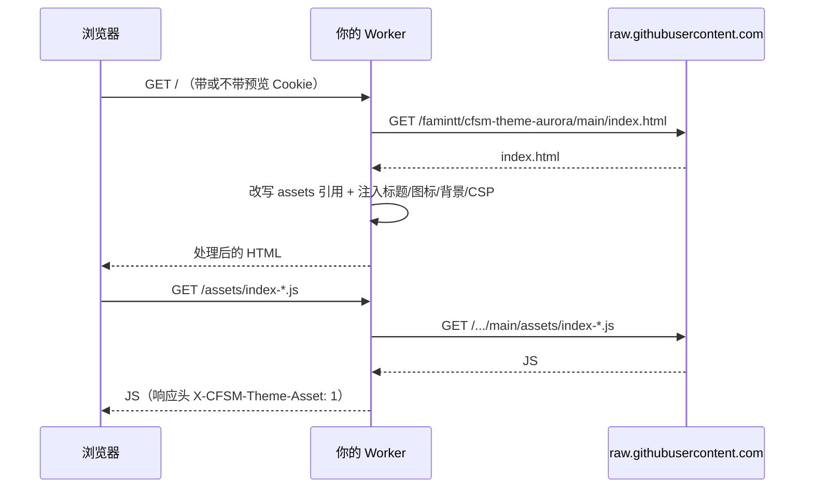

# Aurora · CF-Server-Monitor 主题

> 一套自带极光氛围的 [CF-Server-Monitor](https://github.com/huilang-me/CF-Server-Monitor) 第三方主题。
> 仓库根目录放的是**构建产物**（`index.html` + `assets/`），面板直接反代加载，**不需要你自己构建、也不需要改 Worker 代码**；
> 源码在 [`source/`](source/)（Vue 3 + Vite），想改配色或加功能看 [源码与构建](#源码与构建)。

<p align="left">
  
  
  
  
</p>


> 封面为设计示意图，实际界面以运行效果为准。

**一句话安装**：后台 → 设置 → 「第三方主题地址」填
`https://github.com/famintt/cfsm-theme-aurora/tree/main` → 保存 → 打开首页。

---

## 目录

- [它是什么](#它是什么)
- [界面与功能](#界面与功能)
- [仓库结构](#仓库结构)
- [准备工作](#准备工作)
- [安装：3 步接入](#安装3-步接入)
- [详细步骤](#详细步骤)
  - [第 1 步：拿到主题地址](#第-1-步拿到主题地址)
  - [第 2 步：填写到面板后台](#第-2-步填写到面板后台)
  - [第 3 步：验证](#第-3-步验证)
- [上线前先预览（不影响访客）](#上线前先预览不影响访客)
- [后台设置如何影响主题](#后台设置如何影响主题)
- [回滚到默认主题](#回滚到默认主题)
- [工作原理](#工作原理)
- [缓存、更新与「改了没生效」](#缓存更新与改了没生效)
- [常见问题 FAQ](#常见问题-faq)
- [兼容性](#兼容性)
- [源码与构建](#源码与构建)
- [致谢](#致谢)

---

## 它是什么

CF-Server-Monitor 跑在 Cloudflare Workers 上，它的**前台**（访客看到的监控首页）是一个可以被替换的单页应用；
**后台管理界面永远使用内置版本**，任何主题都影响不到它。

Aurora 就是那个「可被替换的前台」。启用后：

- 访客打开 `https://你的域名/` → 看到 Aurora 的界面；
- 你打开 `https://你的域名/admin#/admin` → 仍然是官方内置后台。

面板在服务端把本仓库的 `index.html` 与 `assets/*` **反向代理**到你的域名下，因此主题的所有请求都是**同源**的：
不需要配 CORS，不需要额外部署静态站点，也不需要绑定新域名。

## 界面与功能

| 页面 | 路由 | 内容 |
| --- | --- | --- |
| 监控首页 | `/#/` | 顶部汇总 + 服务器卡片网格 |
| 服务器详情 | `/#/server/:id` | 单机详情与历史数据 |
| 墨水屏视图 | `/#/epaper` | 纸质/墨水屏风格的汇总页，**可一键打印或导出 PDF** |

**首页汇总区（4 块）**

- **节点**：在线数 / 总数，异常时高亮离线台数；
- **流量最大节点**：本月流量最高的机器及其流量；
- **本月流量**：所有机器 `↓下载 / ↑上传` 合计；
- **实时速度**：当前总速率，附最近约 1 分钟的迷你走势图。

**服务器卡片**

- 名称、地区徽标、故障标记、`系统 · 架构`；
- 在线状态 + 已在线时长（离线时显示「离线 N 分钟/小时/天」）；
- 到期时间徽标（后台开启「显示到期时间」时）；无到期时间显示 `∞`；
- 四个进度条：**CPU**（含核心数）、**内存**、**硬盘**、**流量**（后台开启「显示流量」时，无限流量显示 `x / ∞`）；
- 网络行：实时 `↓ / ↑` 速率 + 累计 `↓ / ↑` 流量 + `T:TCP连接数` / `U:UDP连接数`，宽屏六项同排，窄屏自动换行；
- 三网延迟行：电信 / 联通 / 移动（名称可在后台自定义），显示如 `100ms（5.1%）`，丢包率保留一位小数；后台开启「显示三网延迟」时才展示。

**外观菜单（右上角调色板图标）**

| 选项 | 取值 | 作用 |
| --- | --- | --- |
| 外观 | 深色 / 浅色 / 跟随系统 | 跟随后台默认值；「跟随系统」随操作系统的浅色 / 深色自动切换 |
| 主题色 | 极光 / 翡翠 / 樱花 / 琥珀 | 进度条、图表、选中态与背景光晕的主色 |
| 密度 | 舒适 / 紧凑 | 紧凑模式收紧间距与卡片内边距，一屏多放一行节点 |
| 迷你走势 | 开 / 关 | 控制「实时速度」块里的 1 分钟走势小图 |
| 语言 | 中文 / EN | 只影响当前浏览器，不改后台设置 |

改动立即生效，并记在浏览器本地（`localStorage` 的 `cfsm-theme-ui`）。
管理员登录后改动还会写进面板的 `theme_options`，作为**其他访客的默认值** —— 访客自己的选择优先级更高。

**视图切换**

首页节点区右上角有「卡片视图 / 列表视图」两个按钮。列表视图是一张表格：名称、状态、CPU、内存、硬盘、本月流量、网络、延迟、到期，点击行即进入详情页。选择同样会被记住。


**全局**

- 中文 / 英文界面（跟随后台语言设置）；
- 深色 / 浅色切换（右上角按钮）；
- 页脚：站点名 + `v版本号` + 最后更新时间 + `Powered by CF-Server-Monitor` 链接；
- 桌面与移动端自适应；加载中显示骨架屏，加载失败提供重试按钮；
- 站点开启 **Cloudflare Turnstile** 时先过一道人机验证，通过后才拉数据；
- 实时连接被面板判定为长时间挂起时弹提示，可「继续」保持长连或关闭。

> 主题开箱即用：显示哪些指标由后台决定；配色、密度、迷你走势、语言是每位访客在右上角外观菜单里自选的偏好，不需要运维介入。

## 仓库结构

```
.
├── index.html                          # 构建产物 · 主题入口（面板反代的就是它）
├── assets/                             # 构建产物 · 前端资源（面板反代 /assets/*）
│   ├── index-DwrCMCdN.js               # 主包（~149 KB，含路由、API、i18n、外观状态）
│   ├── index-LZee5jp-.css              # 主样式（含 4 套主题色与密度变量）
│   ├── Dashboard-Mgrg1Tz8.js           # 首页分块
│   ├── Dashboard-CQLUiOOp.css
│   ├── ServerDetail-DW6PQ4d3.js        # 详情页分块
│   ├── ServerDetail-es1xsQdL.css
│   ├── Epaper-CLUtUQnY.js              # 墨水屏视图分块
│   ├── Epaper-DQ87YXFa.css
│   ├── FooterBar-Ua2ZOhQi.js           # 头部（含外观菜单）+ 页脚分块
│   └── FooterBar-BtZWTPP0.css
├── source/                             # 源码（Vue 3 + Vite，见「源码与构建」）
│   ├── src/
│   ├── index.html                      # 开发模板
│   ├── package.json
│   ├── package-lock.json
│   └── vite.config.js
└── docs/                               # 封面图、界面截图与可选的 Actions 模板
    ├── preview.png                     # 仓库封面（1200×630）
    ├── preview.svg                     # 封面源文件
    ├── screenshot-dashboard.png        # 首页 · 浅色卡片视图
    ├── screenshot-dark.png             # 首页 · 深色
    ├── screenshot-list.png             # 首页 · 列表视图
    └── build-theme.yml                 # 复制到 .github/workflows/ 即可手动触发构建
```

**主题加载只会用到根目录的 `index.html` 与 `assets/`。** 这两处是构建产物，不要手改；
要改就改 `source/` 再重新构建。文件名里的哈希是构建指纹，升级时会变，属于正常现象 —— **不要手动重命名**，否则页面会白屏。

## 准备工作

开始前确认：

1. 已部署 **CF-Server-Monitor**（Cloudflare Workers + D1），首页能正常打开；
2. 知道后台入口与密码：
   - 地址：`https://你的Worker域名/admin#/admin`
   - 用户名：`admin`
   - 密码：部署时设置的 **`API_SECRET`**
3. Worker 能访问外网（默认可以，用于回源拉取主题文件）。

> 不需要 fork、不需要下载、不需要重新 `wrangler deploy`。**只需要在后台填一个地址。**

## 安装：3 步接入

```
① 复制主题地址
   https://github.com/famintt/cfsm-theme-aurora/tree/main
        ↓
② 后台 → 设置 → 第三方主题地址 → 粘贴 → 保存
        ↓
③ 打开 https://你的域名/ ，看到 Aurora 即成功
```

## 详细步骤

### 第 1 步：拿到主题地址

面板只接受 GitHub 的 **`tree` 形式**地址，格式必须是：

```
https://github.com/<用户名>/<仓库名>/tree/<分支或提交>[/子目录]
```

本主题对应地址：

```
https://github.com/famintt/cfsm-theme-aurora/tree/main
```

> ⚠️ **不要**填 `https://github.com/famintt/cfsm-theme-aurora`（缺少 `/tree/main`）。
> 面板对地址做的是严格白名单校验：必须 `https://`、域名必须正好是 `github.com`、
> 路径里必须有 `tree` 段、且不能带 `?`、`#`、用户名密码等。
> 校验不通过时**不会报错，而是把地址静默清空** —— 表现为「保存了但主题没变」。

想锁定版本、不跟着仓库更新走，就把 `main` 换成 **40 位提交哈希**：

```
https://github.com/famintt/cfsm-theme-aurora/tree/0123456789abcdef0123456789abcdef01234567
```

（哈希请到仓库的 Commits 页面复制，替换上面这串示例。）

### 第 2 步：填写到面板后台

1. 打开 `https://你的Worker域名/admin#/admin`，用 `admin` / `API_SECRET` 登录；
2. 进入后台的**设置**页（「站点设置」或「外观设置」，主题相关字段在其中一页的「主题」分组里）；
3. 找到 **「第三方主题地址」** 输入框（部分版本写作「第三方主题 GitHub tree 地址」）；
4. 粘贴第 1 步的地址；
5. 点击**保存**。

保存后发生了什么：

- 地址写入 D1 的 `settings` 表 —— 具体是 `site_options` 这行里的 `theme_url` 字段；
- 前台请求 `/` 时，Worker 改为拉取
  `https://raw.githubusercontent.com/famintt/cfsm-theme-aurora/main/index.html`；
- HTML 里的 `assets/...` 引用会被自动改写成 `/assets/...`，由**你自己的 Worker** 代理回源。

### 第 3 步：验证

用**无痕窗口**打开 `https://你的Worker域名/`（排除缓存干扰）：

| 现象 | 结论 |
| --- | --- |
| 出现 Aurora 界面 | ✅ 成功 |
| 仍是默认主题 | 见 [FAQ](#常见问题-faq) 第 1 条 |
| 502 / 白屏 | 见 [FAQ](#常见问题-faq) 第 2、3 条 |
| 界面在但数据全是 `—` | 见 [FAQ](#常见问题-faq) 第 6 条 |

接着依次确认：

- 点任意卡片 → `/#/server/<id>` 详情页正常；
- 访问 `/#/epaper` → 墨水屏页正常，点「打印」能出 PDF；
- 右上角切换明暗 → 配色变化；
- 访问 `/admin#/admin` → 后台仍是**内置界面**（这是正常的，主题不影响后台）。

## 上线前先预览（不影响访客）

不想让访客看到半成品，用**预览模式** —— 直接在首页地址后加 `?theme_url=`：

```
https://你的Worker域名/?theme_url=https://github.com/famintt/cfsm-theme-aurora/tree/main
```

带参数访问时，Worker 会：

- 把地址写进名为 `cfsm_theme_preview` 的 Cookie，**有效期 1 小时**（`Path=/`、`SameSite=Lax`），
  这 1 小时内你在同域名的浏览都会用该主题渲染；
- 之后不带参数访问首页，该 Cookie 会被自动清除，恢复正常。

> **预览需要管理员身份。** 未登录会直接返回 `401 Theme preview requires admin login`。
> 正确姿势：先在同一个浏览器里登录 `/admin#/admin`，再访问带 `?theme_url=` 的首页。

预览只影响你自己的浏览器 —— 访客看到的始终是后台已保存的主题。

## 后台设置如何影响主题

主题不硬编码站点信息，下面这些都在后台控制：

**外观类**

| 后台设置 | 主题中的表现 |
| --- | --- |
| 站点标题 `site_title` | 替换页面 `<title>`、页头品牌名、页脚站点名 |
| 站点图标 `favicon` | 同时替换 `rel="icon"` 与 `rel="apple-touch-icon"` |
| 自定义背景 `custom_bg` / `custom_bg_mobile` | 作为页面背景注入（移动端单独一张） |
| 自定义 CSS / 自定义 Head `custom_head` | 注入到 `</head>` 之前 |
| 自定义脚本 `custom_script` | 注入到 `</body>` 之前 |
| 深色 / 浅色、中文 / 英文 | 决定主题初始配色与界面语言 |
| 外观默认值 `theme_options` | 后台保存的主题色 / 密度 / 迷你走势 / 视图，作为**首次访问**的访客的默认值；访客自己改过之后以本地为准 |

**数据展示类**（系统配置，影响卡片显示哪些指标）

| 开关 | 影响 |
| --- | --- |
| 显示到期时间 `show_expire` | 开启后卡片显示到期徽标，关闭则不显示 |
| 显示流量 `show_tf` | 开启后显示流量进度条与累计流量 |
| 显示三网延迟 `show_three_net_details` | 开启后卡片底部显示电信/联通/移动延迟 |
| 三网名称 `custom_ct_name` / `custom_cu_name` / `custom_cm_name` | 自定义三个运营商在界面上的显示名 |

> **提示：CSP。** 面板会先**删掉主题自带的 CSP `<meta>`**，再根据后台配置重新拼一个 CSP。
> 如果你往主题里加了外部字体 / 图片 / CDN，需要在后台 **CSP 设置**里放行对应域名，否则会被浏览器拦截
> （被拦的域名会直接打印在控制台报错里）。

## 回滚到默认主题

1. 登录 `/admin#/admin` → 设置页；
2. 把「第三方主题地址」**清空**；
3. 保存；
4. 首页立刻回到官方内置主题 —— **不需要重新部署**。

只想临时看看默认主题？用无痕窗口打开首页即可（无痕窗口没有预览 Cookie）。

## 工作原理



几个关键点：

- **只反代两个路径**：主题的 `index.html`，以及任何以 `/assets/` 开头的文件。
  其他文件（README、源码、图片）**不会**被代理。
- **同源**：`assets` 从你自己的域名下发，主题里 `window.location.origin` 天然就是正确的 API 地址，
  所以**不需要任何跨域配置**。
- **后台不可替换**：`/admin` 与 `/admin/*` 永远走内置界面；访问 `/admin/`（带斜杠）会 302 跳到 `/admin#/admin`。
- **安全响应头**：主题页面被加上 `X-Frame-Options: DENY` 与 `X-Content-Type-Options: nosniff`，
  防止被 iframe 嵌套与 MIME 嗅探。
- **失败即报错，不会静默回退**：
  - 拉不到 `index.html` → `502 Theme index.html is unavailable`
  - 拉不到某个资源 → `Theme file not found`

## 缓存、更新与「改了没生效」

| 地址中的 ref | 面板缓存 | 浏览器缓存 |
| --- | --- | --- |
| 分支名（如 `main`） | **1 小时** | 普通缓存 |
| 40 位提交哈希 | **24 小时** | `immutable`（一年） |

所以填分支名时，**主题仓库更新后最多要等 1 小时才生效**。

想立刻看到最新效果：

- 强制刷新：`Ctrl/Cmd + Shift + R`；
- 或换一个 ref（等同于换缓存 key）：例如临时把 `main` 改成某个新提交哈希，再改回来。

选型建议：

- 想「始终跟随最新」→ 用分支 `main`，接受最长 1 小时延迟；
- 想「绝对稳定、加载最快」→ 用**提交哈希**，等价于固定版本，缓存 24 小时。

## 常见问题 FAQ

<details>
<summary><b>1. 保存后前台还是默认主题</b></summary>

按顺序排查：

1. 地址是否**带 `/tree/<ref>`**？只填仓库地址会被判定无效并静默清空。
2. 是否点了保存，并看到成功提示（不是只有输入框变了）。
3. 换无痕窗口 / 强刷，排除浏览器缓存。
4. 分支名是否写错 —— 本仓库只有 `main`，没有 `master`。
5. 打开 `https://你的域名/api/config` 确认服务本身是活的。
</details>

<details>
<summary><b>2. 502 / 提示「Theme index.html is unavailable」</b></summary>

Worker 拉不到 `https://raw.githubusercontent.com/famintt/cfsm-theme-aurora/main/index.html`。常见原因：

- 分支名写错（写成了 `master` 之类）；
- 仓库被设为私有（私有仓库无法被反代）；
- 你 fork 之后把 `index.html` 删了或改名了；
- Cloudflare 到 GitHub 的临时网络问题 —— 等几分钟重试。
</details>

<details>
<summary><b>3. 页面出来了但样式全丢 / 白屏</b></summary>

说明 `index.html` 拿到了，但 `assets/*` 没拿到（控制台里能看到 `/assets/...` 404 或 `Theme file not found`）。通常是：

- `assets/` 目录没有一起上传（必须整目录保留）；
- 文件名被手动改过（哈希文件名不能改）；
- 用了子目录部署，但地址里漏写了子目录。
</details>

<details>
<summary><b>4. 控制台报 CSP 拦截（字体 / 图片 / 脚本被 block）</b></summary>

面板会用后台配置**重建** CSP，主题自带的 CSP 会被删除。因此：

- 主题若引用了外部资源，需要你在后台 CSP 设置里放行对应域名；
- 报错信息里会直接写出被拦的域名，照着加即可。
</details>

<details>
<summary><b>5. 预览链接报 401</b></summary>

`Theme preview requires admin login` —— 预览必须带管理员身份。
先在当前浏览器登录 `/admin#/admin`，再访问带 `?theme_url=` 的地址。
</details>

<details>
<summary><b>6. 界面正常，但卡片上很多数值显示 <code>—</code></b></summary>

这是**数据**没到，不是主题坏了。依次检查：

1. 后台「系统配置」里是否关掉了「显示流量」「显示三网延迟」「显示到期时间」等开关；
2. 探针/Agent 是否正常上报（进后台看该节点最近上报时间）；
3. 三网延迟为 `—` 表示该线路没探测到（超时/关闭），属正常；
4. 内存、磁盘在某些系统上取不到时也会显示 `—`。
</details>

<details>
<summary><b>7. 管理员看到的和访客看到的不一样</b></summary>

预期行为：预览 Cookie 只存在于你自己的浏览器，1 小时后自动失效；访客看到的永远是后台保存的主题。
</details>

<details>
<summary><b>8. 能把主题放自己的 CDN 或别的域名吗？</b></summary>

不行。面板只接受 `github.com` 的 `tree` 地址，并固定从 `raw.githubusercontent.com` 回源。
想要「CDN 级」体验，就填**提交哈希** —— 边缘缓存 24 小时，且浏览器端 immutable。
</details>

<details>
<summary><b>9. 主题商店里怎么搜不到 Aurora？</b></summary>

主题商店的列表来自官方维护的 `CFSM-Theme-Store` 仓库，收录需要单独提 PR。
Aurora 目前**不在商店里**，请按本文手动填写地址接入。
</details>

<details>
<summary><b>10. 换成自己的域名 / workers.dev 域名有区别吗？</b></summary>

没有区别，主题不关心域名。只要前台和 `/api/*` 同源（默认部署就是同源），主题就能正常工作。
</details>

<details>
<summary><b>11. 外观菜单改了，别的访客会跟着变吗？</b></summary>

分两层：访客自己的选择只存在他自己的浏览器里（`localStorage` 键 `cfsm-theme-ui`），彼此互不影响；
管理员登录后改动会写进面板的 `theme_options`，**只作为新访客的默认值**，不会覆盖老访客已经选好的外观。
想恢复默认，清掉该站点的浏览器数据即可。
</details>

## 兼容性

- 已在 **CF-Server-Monitor `2.8.7 Beta6`** 验证；
- 依赖接口：`/api/config`、`/api/servers`、`/api/server`、`/api/history/all`，以及 WebSocket 实时推送；
- 不依赖已废弃的 `config.json`；API 地址默认取**同源**。只有跨域部署时才需要在构建时传 `API_BASE`，
  `vite.config.js` 会把它写进 `<meta name="apiBase">`（驼峰，注意大小写），主题据此指向别的 Worker；
- 内置主题专属的「显示模式」（`bar` / `ring` / `table`）与「深浅色」是**内置主题**的全局设置，
  第三方主题可以读取也可以忽略 —— Aurora 只使用深浅色；
- 站点开启 Turnstile 时，主题会从 `challenges.cloudflare.com` 加载验证脚本；
  若你在面板里自定义过 CSP（`csp_static`），记得放行该域名。

## 源码与构建

源码在 [`source/`](source/)：**Vue 3 + Vite**，没有 TypeScript，也没有额外的状态管理库（数据层就是一个 `reactive` 的 `monitor` 对象）。
`npm run build` 输出到 `source/dist`，把产物覆盖到仓库根目录即完成发布。

### 目录速览

| 路径 | 作用 |
| --- | --- |
| `source/src/views/` | 三个页面：`Dashboard.vue`、`ServerDetail.vue`、`Epaper.vue` |
| `source/src/components/` | `ServerCard`、`SummaryHero`、`LineChart`、`MetricRing`、`AppHeader`、`FooterBar` 等 |
| `source/src/stores/monitor.js` | 数据层：拉 `/api/*`、建 WebSocket、断线重连、`localStorage` 持久化 |
| `source/src/utils/` | `config.js`（API 地址与存储键）、`format.js`（单位换算）、`i18n.js`（中英词条）、`ws.js` |
| `source/src/styles/main.css` | 配色、圆角、密度等 CSS 变量与全局样式 |

### 本地开发

```bash
cd source
npm install
npm run dev        # http://localhost:5173
```

开发服务器会把 `/api`、`/flags`、`/os-icons` 代理到 `http://127.0.0.1:8787`（`wrangler dev` 的默认端口），
本地把面板跑起来就能联调真实数据。要指向别的地址：

```bash
VITE_DEV_PROXY_TARGET=http://127.0.0.1:8787 npm run dev
```

### 构建并发布到根目录

```bash
cd source
npm run build
rm -rf ../assets && cp -R dist/assets ../assets && cp dist/index.html ../index.html
```

Windows PowerShell：

```powershell
cd source
npm run build
Remove-Item ..\assets -Recurse -Force
Copy-Item dist\assets ..\assets -Recurse
Copy-Item dist\index.html ..\index.html -Force
```

提交推送后即生效，面板按分支缓存 1 小时（见 [缓存、更新与「改了没生效」](#缓存更新与改了没生效)）。

不想本地装 Node 也行：`docs/build-theme.yml` 是一个现成的 Actions 模板（**手动触发**，从 `source/`
构建后把产物提交回根目录）。把它复制到仓库的 `.github/workflows/` 下，就能在 Actions 页面点 **Run workflow** 使用。

### 构建期变量

写进 `source/.env`，或用 `API_BASE=... npm run build` 临时传入：

| 变量 | 作用 |
| --- | --- |
| `API_BASE` | 写进 `<meta name="apiBase">`，用于**跨域**把前台指向别的 Worker，多个用逗号分隔；同源部署留空 |
| `TITLE` | 覆盖 `index.html` 的 `<title>`（后台仍会按站点设置再覆盖一次） |
| `BACKGROUND_IMAGE` | 生成 `--user-background-image`，仅本地调试用 |

### 常见改动位置

- **主题色**：`source/src/styles/main.css` 里 `html[data-accent="aurora|emerald|sakura|amber"]` 两组规则（浅色 / 深色各一套），改 `--accent` 与 `--accent-2` 即可；要加第五套，还要在 `stores/monitor.js` 的 `ACCENTS` 和 `utils/i18n.js` 里补上词条；
- **基础配色**：同一文件顶部的 `--bg` / `--surface` / `--text` 变量；
- **密度**：`html[data-density="compact"]` 那组变量，以及 `.node-card` / `.summary-tile` / `.table-shell` 的内边距；
- **卡片列数**：`Dashboard.vue` 里 `.server-grid` 的 `grid-template-columns`（按可用宽度自动排列，卡片目标最小宽度 500px）；
- **文案**：`source/src/utils/i18n.js`，中英两份；
- **首页四块汇总**：`components/SummaryHero.vue`；
- **外观菜单**：`components/ThemeMenu.vue`（由 `AppHeader.vue` 挂载）；
- **列表视图**：`components/ServerTable.vue`（由 `Dashboard.vue` 挂载，列随后台开关自动增减）；
- **详情页图表**：`components/LineChart.vue` 与 `views/ServerDetail.vue`。

> 访客偏好存在 `localStorage` 的 `cfsm-theme-ui` 键里，结构为 `{ accent, density, sparkline, view }`：
> 首次访问用后台 `theme_options`，之后的本地选择优先 —— 管理员改默认值不会覆盖访客已经选好的外观。

### 从零写一个主题

<details>
<summary>面板对第三方主题的硬性约定</summary>

- 首页路由 `/#/`，详情页 `/#/server/:id`；
- `index.html` 用**相对路径**引用资源（`assets/xxx.js`），面板会改写成 `/assets/xxx.js`；
- **不要**实现后台页面，后台入口直接链到 `/admin#/admin`；
- 保留页脚 **Powered by CF-Server-Monitor** 并链接到 <https://github.com/huilang-me/CF-Server-Monitor>；
- 国旗 / 系统图标用面板提供的 `/flags/<code>.svg` 与 `/os-icons/`，不要打包进 `assets/`；
- 站点标题、背景、favicon、custom head 交给后台，别写死。

官方契约：
[theme-develop.md](https://github.com/huilang-me/CF-Server-Monitor/blob/main/theme-develop.md) ·
[theme-ai-prompt.md](https://github.com/huilang-me/CF-Server-Monitor/blob/main/theme-ai-prompt.md)

</details>

## 致谢

- 面板本体：[huilang-me/CF-Server-Monitor](https://github.com/huilang-me/CF-Server-Monitor)
- 主题商店：[huilang-me/CFSM-Theme-Store](https://github.com/huilang-me/CFSM-Theme-Store)
- 主题作者：[famintt](https://github.com/famintt)

本项目为 CF-Server-Monitor 的第三方主题，与 Cloudflare、CF-Server-Monitor 官方无隶属关系。
